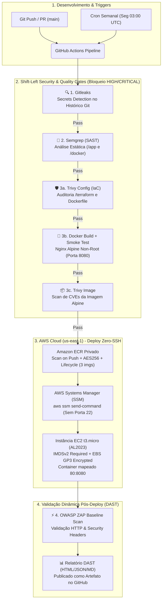

# 🛡️ AWS DevSecOps Container Pipeline


-2496ED?logo=docker&logoColor=white)


Projeto de portfólio de **Engenharia DevSecOps e Arquitetura Cloud AWS** que automatiza de ponta a ponta o provisionamento de infraestrutura segura como código (Terraform), a construção de um container web **Nginx sobre Alpine Linux** endurecido (*hardened* e *non-root*), a validação contínua por **Quality Gates** automatizados e o deploy **Zero-SSH** em uma instância Amazon EC2 via **AWS Systems Manager (SSM)**.

---

## 📐 1. Visão Geral da Arquitetura e Fluxo do Pipeline

A arquitetura foi desenhada sob o princípio de **Defesa em Profundidade (Defense-in-Depth)** e **Zero Trust**, eliminando acessos administrativos expostos (como a porta `22/SSH`) e integrando verificações de segurança desde o commit (*Shift-Left*) até a validação dinâmica pós-deploy (*DAST*).



---

## 📂 2. Estrutura do Repositório

```text
aws-devsecops-container-pipeline/
├── .github/
│   └── workflows/
│       └── devsecops-pipeline.yml   # Pipeline CI/CD com 4 ferramentas de segurança e deploy via SSM
├── app/
│   ├── index.html                   # Dashboard DevSecOps interativo com inspetor de headers em tempo real
│   ├── styles.css                   # Folha de estilos externa (compatível com CSP estrito sem unsafe-inline)
│   ├── app.js                       # Lógica client-side segura (sem innerHTML) e verificação HTTP HEAD
│   └── robots.txt                   # Política de indexação limpa para varredura do OWASP ZAP
├── docker/
│   ├── Dockerfile                   # Imagem nginx:1.27.4-alpine3.21 non-root, porta 8080 e HEALTHCHECK
│   ├── nginx.conf                   # Hardening HTTP: server_tokens off + cabeçalhos de segurança obrigatórios
│   └── .dockerignore                # Exclusão de artefatos de infraestrutura e metadados Git
├── terraform/
│   ├── versions.tf                  # Versões do Terraform (>= 1.5) e provider AWS (~> 5.0)
│   ├── variables.tf                 # Variáveis parametrizadas (região us-east-1, instância t3.micro, CIDR)
│   ├── main.tf                      # VPC, Security Group Zero-SSH, IAM Role (SSM+ECR), ECR e EC2 Hardened
│   ├── user_data.sh                 # Script de bootstrap da EC2 (instalação e ativação do Docker + SSM)
│   ├── outputs.tf                   # Outputs: IP público da EC2, URL do ECR e ID da instância
│   └── terraform.tfvars.example     # Exemplo de arquivo de variáveis
├── .dockerignore                    # Contexto de build enxuto na raiz
├── .gitignore                       # Proteção contra commit de estados do Terraform e variáveis locais
└── README.md                        # Documentação técnica e guia de reprodução
```

---

## 🧠 3. Decisões Arquiteturais e Escolhas Técnicas

### Por que exatamente estas 4 ferramentas de segurança?
Um erro comum em pipelines DevSecOps é empilhar ferramentas redundantes que geram fadiga de alertas (*alert fatigue*) e alto tempo de execução. Este projeto adota **4 ferramentas complementares**, cobrindo 100% das camadas sem sobreposição:

| Ordem | Ferramenta | Camada | Justificativa Técnica |
| :--- | :--- | :--- | :--- |
| **1** | **Gitleaks** | **Secrets Detection** | Especialista em entropia e expressões regulares no histórico Git (`fetch-depth: 0`). Impede que chaves AWS (`AKIA...`), tokens ou chaves privadas cheguem ao estágio de build. |
| **2** | **Semgrep** | **SAST (Código & Config)** | Motor de análise semântica rápida na árvore sintática (AST) para auditar `/app` (HTML/JS) e `/docker` contra padrões OWASP Top 10 (como DOM XSS e configurações inseguras). |
| **3** | **Trivy** | **IaC + Container Image** | Substitui múltiplas ferramentas isoladas (como tfsec, checkov, hadolint e grype) em um único binário oficial: audita o Terraform e o `Dockerfile` (`trivy config`) antes do build e escaneia pacotes do SO Alpine (`trivy image --ignore-unfixed`) após o build. |
| **4** | **OWASP ZAP** | **DAST (Pós-Deploy)** | Valida a aplicação **real em execução** na EC2 através da rede pública, garantindo que os cabeçalhos HTTP de segurança do Nginx estão efetivamente ativos em produção. |

### Por que Container Baseado em Alpine Linux e Execução Non-Root?
1. **Superfície de Ataque Mínima (`nginx:1.27.4-alpine3.21`):** A base Alpine Linux possui apenas ~7 MB e um número mínimo de pacotes instalados, reduzindo drasticamente a quantidade de CVEs em comparação a imagens baseadas em Debian/Ubuntu.
2. **Atualização Contínua Semanal (`schedule` cron):** O workflow executa toda **segunda-feira às 03:00 UTC**, rodando `apk update && apk upgrade --no-cache` durante o build para incorporar correções de segurança recém-lançadas.
3. **Isolamento de Privilégios (`USER nginx` na porta `8080`):** Caso ocorra uma vulnerabilidade no processo worker do Nginx, o atacante fica confinado a um usuário sem privilégios (`uid=101(nginx)`), incapaz de modificar binários do sistema ou escalar privilégios no host EC2.
4. **Hardening no `nginx.conf`:**
   - `server_tokens off`: Oculta a versão exata do Nginx nos cabeçalhos `Server` e páginas de erro.
   - `Content-Security-Policy`: Política estrita (`default-src 'self'`) sem uso de `'unsafe-inline'` ou `'unsafe-eval'`.
   - `X-Frame-Options: DENY` e `frame-ancestors 'none'`: Proteção total contra *Clickjacking*.
   - `X-Content-Type-Options: nosniff`: Previne ataques de *MIME-sniffing*.
   - `Referrer-Policy: strict-origin-when-cross-origin` e `Permissions-Policy` restritiva.

### Controles de Segurança na Infraestrutura AWS (`/terraform`)
- **Zero-SSH (Porta 22 Fechada):** O Security Group libera exclusivamente a porta `80/TCP` (entrada HTTP) e `443/TCP` (saída HTTPS para os endpoints do AWS SSM, Amazon ECR e repositórios do Amazon Linux 2023). Todo o deploy é orquestrado via `aws ssm send-command`.
- **Proteção contra SSRF no EC2 (`IMDSv2` Obrigatório + Hop Limit = 1):** Configurado com `http_tokens = "required"` e `http_put_response_hop_limit = 1`. O *hop limit* igual a `1` garante que requisições originadas de dentro de um container Docker (que adicionam um salto de rede extra via bridge) sejam descartadas pelo serviço de metadados `169.254.169.254`.
- **Criptografia e Controle de Custos (AWS Free Tier):** Volume EBS raiz (`gp3`) criptografado em repouso e repositório Amazon ECR com *Scan on Push*, criptografia `AES256` e **Lifecycle Policy** que expira imagens antigas mantendo apenas as **últimas 3 imagens**.

---

## 🚀 4. Guia Passo a Passo de Provisionamento e Deploy

### Pré-requisitos
- Conta AWS ativa (compatível com **AWS Free Tier**).
- [Terraform](https://developer.hashicorp.com/terraform/downloads) `>= 1.5.0` e [AWS CLI v2](https://aws.amazon.com/cli/) instalados localmente (para o provisionamento inicial da infraestrutura).

### Passo 1: Provisionar a Infraestrutura na AWS com Terraform
Clone o repositório e execute o Terraform na pasta `/terraform`:

```bash
git clone https://github.com/eucainapereira/aws-devsecops-container-pipeline.git
cd aws-devsecops-container-pipeline/terraform

# Inicializa os providers
terraform init

# Valida a sintaxe e inspeciona o plano de execução
terraform validate
terraform plan

# Provisiona a VPC, Security Group, IAM Role, ECR e Instância EC2
terraform apply -auto-approve
```

Ao final da execução, o Terraform exibirá os **Outputs**:
- `ec2_instance_id` (ex: `i-0123456789abcdef0`)
- `ec2_public_ip` (ex: `54.210.XX.XX`)
- `ecr_repository_url` (ex: `123456789012.dkr.ecr.us-east-1.amazonaws.com/aws-devsecops-container-pipeline`)

### Passo 2: Configurar os Secrets no GitHub Actions
No seu repositório do GitHub, acesse **Settings > Secrets and variables > Actions** e configure os seguintes *Repository Secrets*:

| Nome do Secret | Obrigatório? | Descrição |
| :--- | :---: | :--- |
| `AWS_ACCESS_KEY_ID` | **Sim** | Access Key ID de um usuário/role IAM com permissão de push no ECR e `ssm:SendCommand` na EC2. |
| `AWS_SECRET_ACCESS_KEY` | **Sim** | Secret Access Key correspondente. |
| `EC2_INSTANCE_ID` | Opcional* | ID da instância EC2 retornado pelo output do Terraform (*se omitido, o pipeline descobre automaticamente via tag `Name=aws-devsecops-container-pipeline-ec2`*). |
| `EC2_PUBLIC_IP` | Opcional* | IP público da EC2 retornado pelo Terraform (*se omitido, o pipeline descobre automaticamente via API da AWS*). |

### Passo 3: Executar o Pipeline DevSecOps
Qualquer `git push` na branch `main` (ou acionamento manual em **Actions > AWS DevSecOps Container Pipeline > Run workflow**) executará automaticamente:
1. Varredura de segredos com **Gitleaks**.
2. Análise estática SAST com **Semgrep**.
3. Auditoria de IaC (`trivy config`), build + smoke test do container non-root e scan de CVEs (`trivy image`) com **Trivy**.
4. Push para o **Amazon ECR** (tags `latest` e `${{ github.sha }}`) e deploy remoto via **AWS SSM**.
5. Varredura dinâmica DAST com **OWASP ZAP** contra `http://<EC2_PUBLIC_IP>` e upload do relatório como artefato da execução.

---

## 🧪 5. Como Testar os Quality Gates (Simulação de Falhas)

Para comprovar para recrutadores e auditores que o pipeline **realmente bloqueia** código ou infraestrutura insegura antes de chegar à produção, você pode realizar os 4 testes abaixo em uma branch ou Pull Request:

### Teste 1: Bloqueio de Vazamento de Credencial (Gitleaks)
Adicione uma chave AWS fictícia em qualquer arquivo do projeto e faça um commit:
```bash
echo "AWS_SECRET_KEY=wJalrXUtnFEMI/K7MDENG/bPxRfiCYEXAMPLEKEY" >> app/app.js
git add app/app.js && git commit -m "test: simula vazamento de credencial"
```
- **Resultado esperado:** O estágio `[1/4] Gitleaks` falhará imediatamente (`exit code 1`) apontando a linha exata do segredo, bloqueando o pipeline.

### Teste 2: Bloqueio de Vulnerabilidade de Código / DOM XSS (Semgrep)
No arquivo `app/app.js`, adicione um trecho vulnerável a *DOM-based XSS*:
```javascript
document.body.innerHTML = window.location.search;
```
- **Resultado esperado:** O estágio `[2/4] Semgrep` detectará a regra de segurança OWASP e interromperá a execução (`--error`).

### Teste 3: Bloqueio de Misconfiguration Cloud ou Container Root (Trivy)
Você pode testar o Trivy de duas formas:
1. **No Terraform (`terraform/main.tf`):** Altere `encrypted = true` para `encrypted = false` no `root_block_device` da EC2 (regra `AVD-AWS-0131` - HIGH) ou adicione uma regra liberando a porta `22` para `0.0.0.0/0` (regra `AVD-AWS-0107` - HIGH).
2. **No Container (`docker/Dockerfile`):** Remova a instrução `USER nginx` ou altere para `USER root` (regra `DS002` - HIGH).
- **Resultado esperado:** O estágio `[3/4 - Etapa A] Trivy Config` reprovará o pipeline com `exit-code 1` antes mesmo de construir a imagem.

### Teste 4: Validação de Cabeçalhos de Segurança no DAST (OWASP ZAP)
Ao final do pipeline, baixe o artefato **`owasp-zap-dast-report`** na aba **Actions** do GitHub para visualizar o relatório HTML completo gerado pelo OWASP ZAP contra o IP público da instância EC2.

---

## 🧹 6. Limpeza de Recursos (Teardown)

Para destruir todos os recursos provisionados na AWS e garantir custo zero após os testes:

```bash
cd terraform
terraform destroy -auto-approve
```
